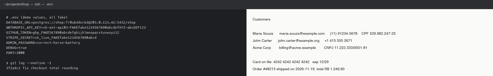
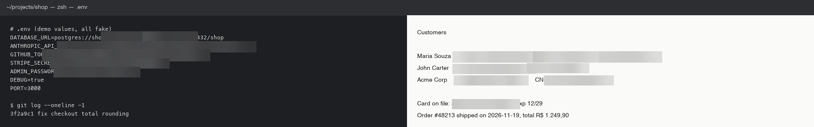

# unleak

**Blur e-mails, phone numbers, API keys and passwords in screen recordings and screenshots, before you share them.** One command. Runs 100% on your computer: nothing is uploaded.

[Website](https://jasonmello.github.io/unleak/) · [Português](README.pt-BR.md)

Before:



After `unleak screen.png`:



(All values in the pictures are fake.)

## Why

You record a demo, a bug report or a class, and a `.env` file, a customer's phone number or your own e-mail is on screen for two seconds. Finding and covering it by hand in a video editor takes longer than recording the video. `unleak` reads the screen with OCR, finds what looks sensitive and hides it in every frame.

## Install

You need [uv](https://docs.astral.sh/uv/) (or pipx). No ffmpeg install is needed; it comes bundled.

```bash
uv tool install git+https://github.com/jasonmello/unleak
```

Works on macOS, Windows and Linux, with Python 3.10 or newer.

## Use

```bash
unleak recording.mp4
```

This writes `recording.unleaked.mp4` (sound kept) and `recording.unleak-report.html`, a page that lists what was hidden and when, so you can check the result quickly.

It works on images too:

```bash
unleak screenshot.png
```

Hide your own terms (a client name, a project code name):

```bash
unleak recording.mp4 --also "Acme Corp" --also "Project Falcon"
```

Terms you always want hidden can live in a `.unleakrc` file (one per line) in your home folder or in the folder you run the command from.

Other options:

| Option | What it does |
|---|---|
| `--style blur\|pixel\|box` | How to hide. `box` paints a solid rectangle. |
| `--only KIND`, `--skip KIND` | Choose what to look for. |
| `--ocr-fps N` | How often to read the screen while it changes (default 2). Higher is safer and slower. |
| `--phone-regions BR,US` | Countries for phone numbers written without a country code. |
| `--dry-run` | Only report, write no output file. |
| `--json` | Print the findings as JSON (for scripts and AI agents). |

## What it finds

| Kind | Examples |
|---|---|
| `secret` | Anthropic, OpenAI, GitHub, GitLab, AWS, Google, Slack, Stripe, Hugging Face, npm and SendGrid keys, JWTs, private key headers |
| `credential` | `password: ...`, `API_KEY=...`, passwords inside connection strings |
| `token` | Long random-looking strings of an unknown format |
| `email`, `phone`, `ip` | E-mail addresses, phone numbers (validated per country), IPv4 addresses |
| `card` | Card numbers (checked with the Luhn algorithm) |
| `cpf`, `cnpj` | Brazilian tax IDs (check digits validated) |
| `custom` | Anything you pass with `--also` or `.unleakrc` |

## Use it from Claude Code or Codex

Copy [`skills/unleak`](skills/unleak) into `~/.claude/skills/`, then ask: *"unleak the recording on my desktop"*. The agent runs the command, reads the JSON and tells you what was hidden. Detection never goes through an AI model: the agent only starts the local command, so your screen is not sent anywhere.

## Limits (read this)

`unleak` lowers the risk. It does not remove it. **Watch the output before you share it.**

- OCR can miss text that is very small, stylised, low contrast or cut off at the edge of the screen.
- Something visible for less than half a second while the screen is busy can be missed. Raise `--ocr-fps` if that matters to you.
- A secret you type character by character is only recognised once enough of it is on screen, so its first characters stay visible until then. Paste secrets instead of typing them, or list them with `--also`.
- It only knows the patterns listed above. A name, an address or an order number is not hidden unless you pass it with `--also`.
- Only what is on screen is covered. Spoken words in the audio are left alone.

Speed: a 20-second 1080p recording with scrolling and typing took 47 seconds on an Apple Silicon laptop. Recordings where the screen is mostly still are much faster, because the screen is only read again when it changes.

## How it works

1. Frames are compared with the last one that was read. A still screen costs nothing.
2. When the picture changes, the frame goes through OCR ([RapidOCR](https://github.com/RapidAI/RapidOCR), on your CPU). Small changes, such as typing, only re-read the strip that changed.
3. Each line of text is checked against the detectors.
4. Frames between two OCR passes are held back and covered with the areas from both passes, so text is hidden from the first frame where it shows up. While the page scrolls, the hidden areas follow the pixels.
5. Each area is shrunk to a few pixels and enlarged again, which destroys the detail instead of smearing it.

More in [docs/architecture.md](docs/architecture.md).

## Roadmap

- A simple drag-and-drop window to review and toggle each finding
- Live mode as an OBS filter
- More detectors (IBAN, national IDs from more countries, IPv6)

## License

[AGPL-3.0-or-later](LICENSE). Copyright (c) 2026 Jason Mello.

You can use, study and change unleak, and contributions are welcome. If you distribute it or a version based on it, you must keep this licence, publish your source and keep the credit.
