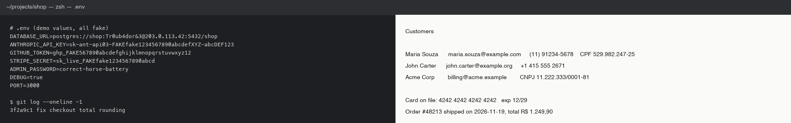
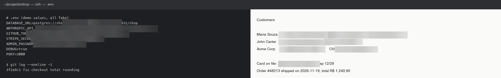

# unleak

**Borra e-mails, telefones, chaves de API e senhas em gravações de tela e prints, antes de você compartilhar.** Um comando. Roda 100% no seu computador: nada é enviado para a internet.

[English](README.md)





(Todos os valores das imagens são falsos.)

## Instalar

Você precisa do [uv](https://docs.astral.sh/uv/) (ou do pipx). O ffmpeg já vem junto.

```bash
uv tool install git+https://github.com/jasonmello/unleak
```

Funciona em macOS, Windows e Linux, com Python 3.10 ou mais novo.

## Usar

```bash
unleak gravacao.mp4
```

Isso cria `gravacao.unleaked.mp4` (com o som) e `gravacao.unleak-report.html`, uma página que lista o que foi escondido e em que momento.

Também funciona com imagens:

```bash
unleak print.png
```

Para esconder termos seus (nome de cliente, nome de projeto):

```bash
unleak gravacao.mp4 --also "Clínica Exemplo" --also "Projeto Falcão"
```

Os termos que você sempre quer esconder podem ficar num arquivo `.unleakrc` (um por linha) na sua pasta pessoal ou na pasta onde você roda o comando.

As demais opções, a lista do que ele encontra e o funcionamento estão no [README em inglês](README.md).

## Limites

O `unleak` reduz o risco, mas não elimina. **Assista ao resultado antes de compartilhar.**

- O OCR pode não ler texto muito pequeno, estilizado, com pouco contraste ou cortado na borda da tela.
- Algo que aparece por menos de meio segundo com a tela em movimento pode passar. Aumente `--ocr-fps` se isso importar.
- Um segredo digitado letra por letra só é reconhecido quando já há o bastante dele na tela, então os primeiros caracteres ficam visíveis até lá. Cole os segredos em vez de digitar, ou informe-os com `--also`.
- Ele só conhece os padrões listados. Nome, endereço ou número de pedido só são escondidos com `--also`.
- Só a imagem é tratada. O que é falado no áudio fica como está.

## Licença

MIT
